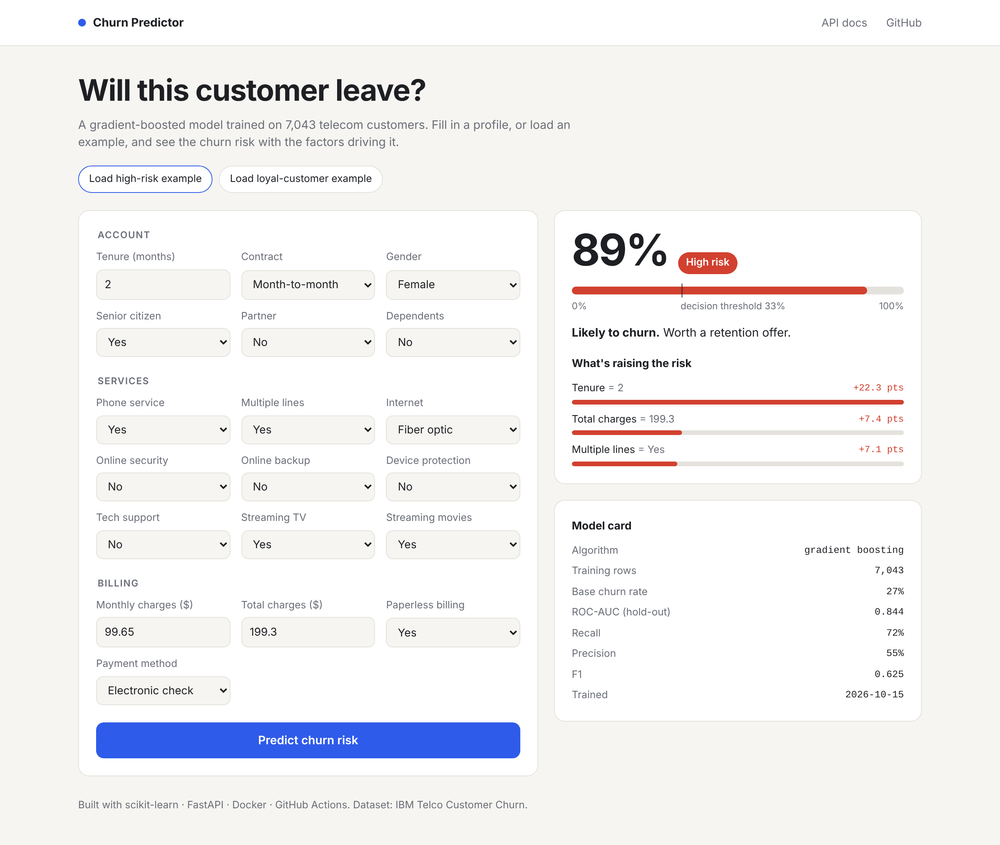
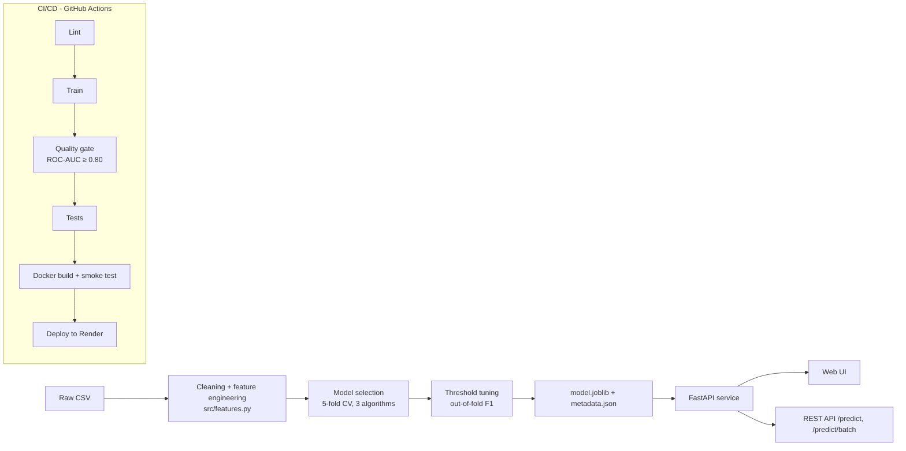

# Customer Churn Predictor — End-to-End ML with Deployment

[](https://github.com/YOUR_USERNAME/churn-predictor/actions)


Predicts whether a telecom customer is about to cancel, **explains why**, and serves it all through a
production-style API and web app.

**Live demo:** https://YOUR-APP.onrender.com · **API docs:** https://YOUR-APP.onrender.com/docs



---

## Why this matters

Acquiring a new customer typically costs far more than keeping an existing one. A model that flags at-risk
customers early, and says *what* is driving the risk, lets a retention team act before the customer leaves.

## Results

Trained on the IBM Telco Customer Churn dataset (7,043 customers, 26.5% churn). Evaluated on a 20% stratified
hold-out set the model never saw during training or threshold tuning.

| Model | 5-fold CV ROC-AUC |
|---|---|
| Logistic Regression | 0.846 |
| Random Forest | 0.847 |
| **Gradient Boosting** (selected) | **0.848** |

**Hold-out performance (Gradient Boosting, threshold 0.33):**

| ROC-AUC | Recall | Precision | F1 | Accuracy |
|---|---|---|---|---|
| 0.844 | 72% | 55% | 0.625 | 77% |

The decision threshold was tuned to maximise F1 on **out-of-fold** predictions rather than the default 0.5,
because missing a churner (false negative) costs more than an unnecessary retention offer. On the hold-out
set this raises recall from 50% to 72%, at the cost of precision dropping from 66% to 55%.

## Architecture



## Key engineering decisions

- **One feature module for training and serving** (`src/features.py`) so the two can never drift apart, a
  common source of silent production bugs.
- **Full scikit-learn `Pipeline`** (scaling + one-hot encoding + model) saved as a single artefact, so raw JSON
  goes in and a prediction comes out.
- **Per-prediction explanations** by occlusion: each input is swapped for a typical retained customer's value
  and the drop in churn probability is reported. Lightweight, model-agnostic, no extra dependencies.
- **Strict input validation** with Pydantic: unknown categories, negative tenure or missing fields return a
  clear `422` instead of a garbage prediction.
- **Model trained inside the Docker build** (multi-stage), so no binary artefacts live in git and every image
  is reproducible from source.
- **Quality gate in CI**: a retrain that drops ROC-AUC below 0.80 fails the pipeline and is never deployed.
- **Non-root container**, health check, and request-timing middleware with structured logs.

## Project structure

```
churn-predictor/
├── data/telco_churn.csv          # IBM Telco Customer Churn dataset
├── src/
│   ├── features.py               # cleaning + feature engineering (shared)
│   └── train.py                  # model comparison, tuning, evaluation
├── app/
│   ├── main.py                   # FastAPI routes
│   ├── model.py                  # model loading, prediction, explanations
│   ├── schemas.py                # Pydantic request/response models
│   └── static/                   # web UI (HTML/CSS/JS, no framework)
├── tests/                        # API + feature tests (pytest)
├── Dockerfile                    # multi-stage: train → slim runtime
├── docker-compose.yml
├── render.yaml                   # Render deploy blueprint
└── .github/workflows/ci.yml      # lint → train → gate → test → docker → deploy
```

## Run locally

```bash
python -m venv .venv && source .venv/bin/activate     # Windows: .venv\Scripts\activate
pip install -r requirements-dev.txt
python -m src.train                                    # trains and writes models/
uvicorn app.main:app --reload                          # http://localhost:8000
pytest -q
```

Or with Docker:

```bash
docker compose up --build                              # http://localhost:8000
```

## API

```bash
curl -X POST https://YOUR-APP.onrender.com/predict \
  -H "Content-Type: application/json" \
  -d '{"gender":"Female","SeniorCitizen":0,"Partner":"No","Dependents":"No","tenure":3,
       "PhoneService":"Yes","MultipleLines":"No","InternetService":"Fiber optic",
       "OnlineSecurity":"No","OnlineBackup":"No","DeviceProtection":"No","TechSupport":"No",
       "StreamingTV":"Yes","StreamingMovies":"Yes","Contract":"Month-to-month",
       "PaperlessBilling":"Yes","PaymentMethod":"Electronic check",
       "MonthlyCharges":95.5,"TotalCharges":286.5}'
```

```json
{
  "churn_probability": 0.7527,
  "will_churn": true,
  "risk_level": "High",
  "threshold": 0.33,
  "top_drivers": [
    {"feature": "tenure", "value": 3, "impact": 0.2837},
    {"feature": "InternetService", "value": "Fiber optic", "impact": 0.1171},
    {"feature": "OnlineBackup", "value": "No", "impact": 0.0334}
  ]
}
```

| Endpoint | Method | Purpose |
|---|---|---|
| `/` | GET | Web UI |
| `/predict` | POST | Score one customer, with top risk drivers |
| `/predict/batch` | POST | Score up to 1,000 customers |
| `/model-info` | GET | Model name, metrics, training date |
| `/health` | GET | Liveness check |
| `/docs` | GET | Interactive Swagger docs |

## Deploy (free) on Render

1. Push this repo to GitHub.
2. On [render.com](https://render.com): **New → Blueprint**, pick the repo. Render reads `render.yaml`.
3. In the Render service, go to **Settings → Deploy Hook** and copy the URL.
4. In GitHub: **Settings → Secrets and variables → Actions → New secret**, name it
   `RENDER_DEPLOY_HOOK_URL`, paste the URL.

Every push to `main` now runs lint, training, the quality gate, tests and a Docker smoke test, and only then
deploys. (Free Render instances sleep when idle; the first request after a pause takes ~30 seconds.)

## Possible next steps

- Track experiments with MLflow and add hyperparameter search (Optuna)
- Monitor data drift on incoming requests (Evidently)
- Add SHAP values for richer explanations
- Cost-based threshold using real retention-offer and lost-customer values

## Dataset

[IBM Telco Customer Churn](https://github.com/IBM/telco-customer-churn-on-icp4d): demographics, services,
account and billing data for 7,043 customers, with a churn label.
